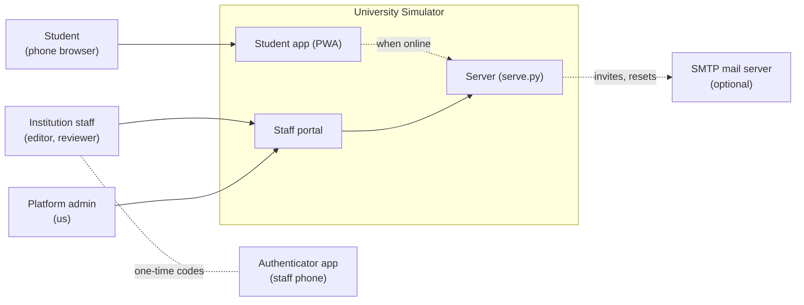
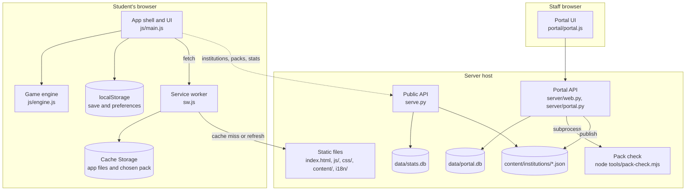
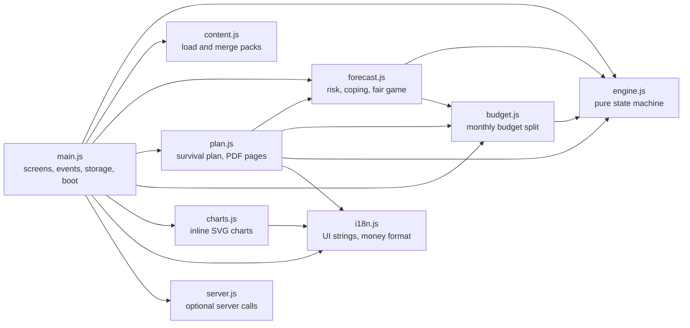
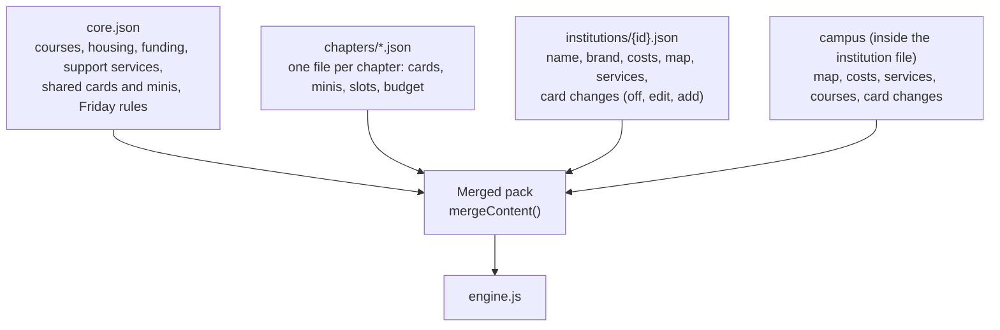
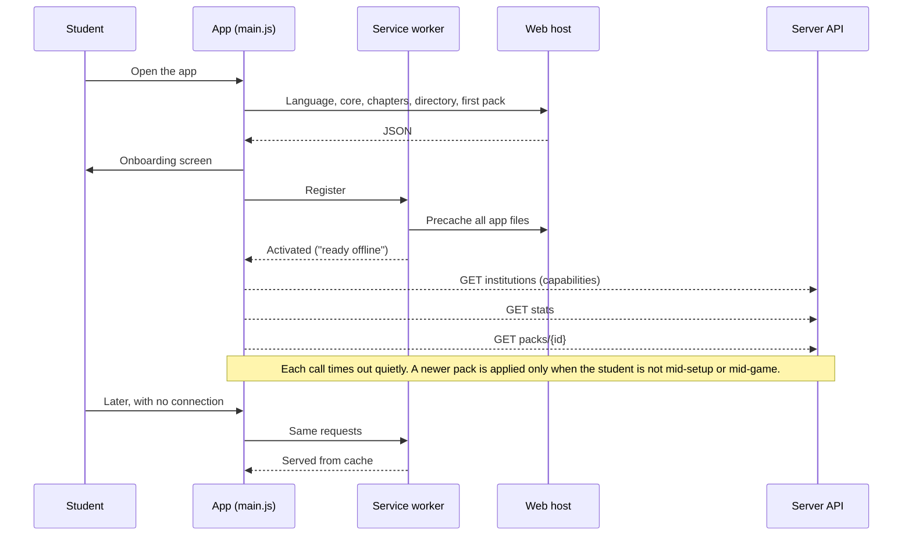
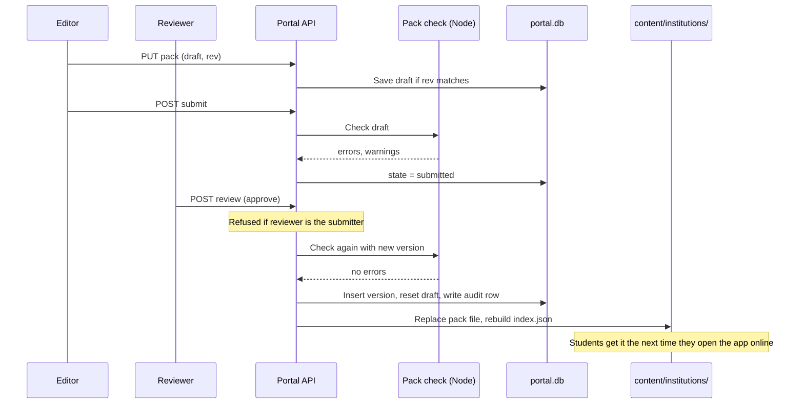
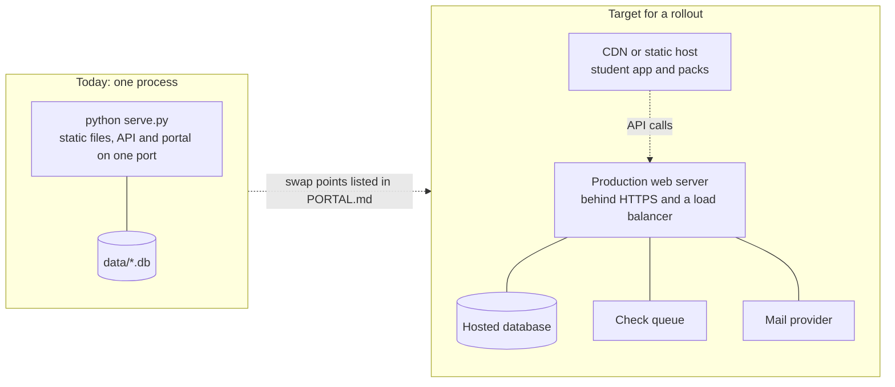

# Architecture

University Simulator is a static, offline-first web app (PWA) with a small optional Python
server. Students play entirely in the browser. The server adds three things when it is
reachable: content updates and anonymous completion counts. It also
hosts the staff portal, where institutions edit their own content.

The reasons behind the main choices are in the [decision records](adr/README.md).

## 1. System context

Who uses the system and what it depends on.



Dotted lines are optional: the student app works with none of them.

## 2. Containers

The deployable and runnable parts.



| Container | Technology | Responsibility |
|---|---|---|
| Student app | Vanilla JavaScript ES modules, no build step | Renders screens, runs the game, saves progress on the device |
| Service worker | `sw.js` | Precaches the app for offline play; keeps the chosen institution's pack in its own cache |
| Static files | Any web host or CDN | Everything a student needs to play |
| Public API | Python standard library `http.server` | Institution list, content packs, completion counts |
| Portal API | Python standard library, SQLite | Staff accounts, drafts, review workflow, publishing, audit log |
| Pack check | Node.js, shares the engine with the app | Validates a pack and plays the whole journey before it is published |
| Portal UI | Vanilla JavaScript | A form over the portal API; enforces nothing itself |

The student app can be hosted as static files alone (Netlify, GitHub Pages). The server is
needed only for the portal, statistics and live pack updates.

## 3. Components of the student app



| Module | Depends on the DOM | Notes |
|---|---|---|
| `engine.js` | No | Every exported function takes a state and returns a new one. Runs in Node for tests and the pack check |
| `content.js` | No (uses `fetch` in its loaders only) | `mergeContent` layers core, chapters, institution and campus into one playable pack |
| `forecast.js`, `budget.js` | No | Transparent rules, not a trained model |
| `plan.js` | Canvas only, for the plan PDF | |
| `main.js` | Yes | The only module that touches `localStorage`, history and the page |

The rule that keeps this testable: **game logic never touches the DOM, and `main.js` never
contains game rules.**

## 4. Content layering

All story content is data. One playable pack is assembled from four layers, each overriding
only what differs.



An institution may change wording and switch cards off. Cards of its own are written by our
team and approved by its reviewer. It may not change
what a choice does: effects, flags and conditions are game rules, and the pack check rejects a
pack that tries.

## 5. Runtime views

### 5.1 First load and offline play



### 5.2 One week of play

```mermaid
stateDiagram-v2
    [*] --> intro: startChapter
    intro --> dashboard: no card this step
    intro --> event: first card
    dashboard --> note: card has a content note
    dashboard --> event: open card
    note --> event: continue
    note --> dashboard: skip (next week)
    event --> outcome: choose
    outcome --> event: undo
    outcome --> support: choice points to a service
    outcome --> event: next card this week
    support --> event: next card this week
    outcome --> friday: Friday week
    support --> friday: Friday week
    friday --> dashboard: next week
    outcome --> dashboard: next week
    support --> dashboard: next week
    event --> forecast: results card, last week
    forecast --> plan
    plan --> [*]: back to map
```

`phase` in the saved state holds the current node. Between weeks the engine pays living
costs, applies the Friday habit and queues the next week's cards against the chapter's card
budget.

### 5.3 Publishing a pack through the portal



## 6. Deployment



Each part a rollout would replace sits behind one named place in the code. The table in
[PORTAL.md](../PORTAL.md#how-it-is-built-and-where-production-parts-plug-in) lists them.

## 7. Cross-cutting concerns

| Concern | Approach |
|---|---|
| Offline | Cache-first service worker; bundled packs; every server call fails quietly |
| Privacy | No account; progress in `localStorage`; statistics carry a random device id only; Campus Realities state is in memory and never saved or sent |
| Internationalisation | UI strings in `i18n/<lang>.json`; content is English only, with translations in `content/lang/<lang>.json` keyed by the English; anything missing falls back to English |
| Output safety | All content and pack text is escaped before it reaches the page |
| Determinism | A journey has a seed; card and mini selection is reproducible from it |
| Versioning | Four independent version numbers; see [data-model.md](data-model.md#version-numbers) |
| Accessibility | Keyboard shortcuts for choices, focus moved to the heading on each screen, live regions on the HUD and charts, contrast enforced on brand colours by the pack check |
| Error handling | Storage and network calls are wrapped; a failed boot shows a single error message |

## 8. Repository layout

| Path | Contents |
|---|---|
| `index.html`, `js/`, `css/`, `i18n/`, `icons/`, `sw.js`, `manifest.webmanifest` | Student app |
| `content/` | Shared content, chapters, institution packs, Campus Realities |
| `portal/` | Staff portal front end |
| `server/` | Portal back end: rules, auth, database, mailer, web routes, admin CLI |
| `serve.py` | The server entry point and public API |
| `tools/` | Pack build, check, audit, reindex, icons, and a static dev server |
| `intake/` | Spreadsheet templates and the Karoo Coast worked example |
| `test/` | Node tests for the app and content; Python tests for the portal |
| `data/` | Runtime databases, outbox and backups. Not in version control |
