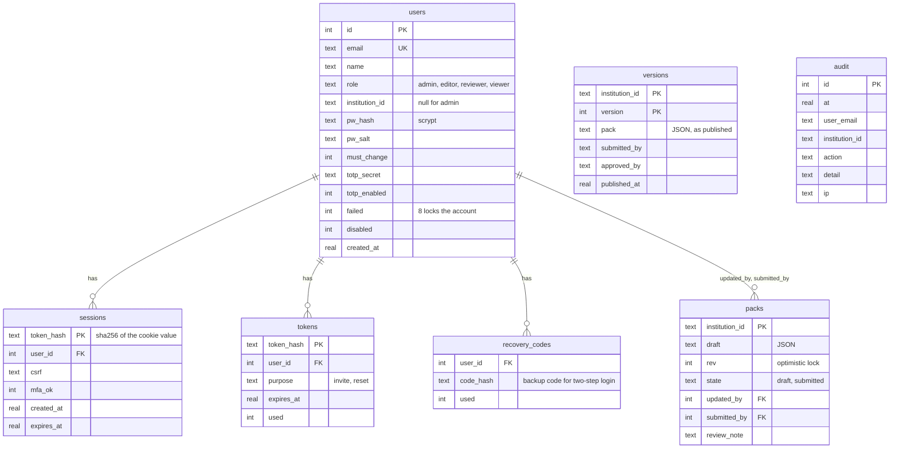

# Data model

What the system stores, where it lives and what shape it has.

## Where data lives

| Data | Location | Owner | In version control |
|---|---|---|---|
| Shared story content | `content/core.json`, `content/chapters/*.json`, `content/realities.json` | Platform team | Yes |
| Institution packs | `content/institutions/{id}.json` and `index.json` | Institution staff, through the portal or intake sheets | Yes |
| Student progress | Browser `localStorage`, key `fys-save-v6` | The student's device | Never leaves the device |
| Student preferences | Browser `localStorage`, key `fys-prefs-v1` | The student's device | Never leaves the device |
| App files for offline play | Cache Storage, `fys-v<N>` | Service worker | n/a |
| Chosen institution pack | Cache Storage, `fys-packs-v1` | Service worker | n/a |
| Completion counts | `data/stats.db` | Server | No |
| Staff accounts, drafts, history, audit | `data/portal.db` | Server | No |
| Demo email | `data/outbox/*.txt` | Server | No |

## Student save (`fys-save-v6`)

One JSON object, created by `newJourney` in [js/engine.js](../js/engine.js). The main fields:

| Field | Type | Meaning |
|---|---|---|
| `v` | number | Save format version. A save with another value is ignored at boot |
| `packVersion` | number | The pack version this save last played on |
| `seed` | number | Seed for reproducible card and mini selection |
| `setup` | object | The setup answers: `institution`, `campus`, `status`, `course`, `housing`, `funding`, `origin`, `laptop`, `family_needs`, `age_role`, `monthlyIncome` |
| `money`, `marks`, `wellbeing` | number | The three visible meters |
| `trackers` | object | Hidden counters: `connection`, `buffer`, `help_seeking`, `family_obligation`, `confidence`, `debt`, `bunk_count` |
| `flags` | string[] | Facts set by choices, read by card conditions |
| `history` | object[] | Every card seen: `{ chapter, week, eventId, choiceId?, tags, skipped? }` |
| `chapter`, `week`, `phase` | | Where the player is now |
| `queue`, `qi` | string[], number | This week's card ids and the position in them |
| `started`, `completed` | string[] | Chapter ids |
| `results` | object | Test results per chapter |
| `recurring`, `scheduled`, `followUps` | | Effects that repeat or arrive later |
| `leaks`, `fridays`, `offered`, `nightHabit` | | Friday-night habit and small spends |
| `supportSeen` | string[] | Services the player has met; shown on the survival plan |
| `snapshots` | object[] | Meter values at the end of each week |
| `budget` | object | The player's own edits to the budget split |
| `feedbackSent` | string[] | Chapters for which feedback was sent |

Nothing in the save identifies a person. Campus Realities progress is deliberately absent:
it is held in a module variable and lost on reload.

## Preferences (`fys-prefs-v1`)

| Field | Meaning |
|---|---|
| `lang` | Chosen language |
| `device` | Random id sent with completion counts |
| `coach` | Which first-time tips have been dismissed |
| `introSeen` | Whether the intro slides were shown |
| `place` | `{ institution, campus }` chosen to open Campus services or Campus Realities before there is a character. A character's own university takes its place once one exists |
| `unsent` | Chapter completions the server has not taken yet: institution and chapter only. Sent when next online |

## Content pack

### Card (event)

The schema and its rules are documented in the [README](../README.md#card-schema-spec-5).
In summary a card has an `id`, a `type`, either a fixed `week` or a `pool`, optional
`conditions`, localised `title` and `text`, and two or three `choices`. Each choice carries
`effects`, `tags`, `flags`, `support`, an `outcome` and an optional `tip`.

### Institution file

| Field | Editable by staff | Meaning |
|---|---|---|
| `id`, `version`, `status`, `type`, `licence`, `signedOff`, `costIndex` | No | Set by the platform or by publishing |
| `name`, `short`, `campus`, `city`, `area`, `province` | Yes | Identity and wording |
| `brand` | Yes | Top-bar name, monogram, light and dark colours |
| `costs` | Yes | `taxi_week` (rent is never part of a student's money in the game) |
| `courses`, `courseList`, `housing` | Yes | What is offered; own programmes |
| `map` | Yes | Buildings on the fixed campus grid |
| `support` | Yes | Per-service overrides: name, building, room, hours, email, contacts, `verified`, `last_checked` |
| `pages` | Yes | Lists a service points to |
| `cards` | Yes | `off`, `edit` (wording only), `add` (own cards; only a platform admin may change these) |
| `campuses` | Yes | A further layer with its own `map`, `costs`, `pages`, `courses`, `support`, `cards` |

The editable and protected sets are defined once, in `EDITABLE` and `PROTECTED` in
[server/portal.py](../server/portal.py).

## Server databases

### `data/portal.db`

`versions` and `audit` have no foreign keys by design: they are a historical record and must
survive an account being removed. `audit` has triggers that abort any update or delete.

Schema changes are numbered migrations in [server/db.py](../server/db.py), applied on start.
Add a migration; never edit an existing one.

### `data/stats.db`

| Table | Columns | Key |
|---|---|---|
| `completions` | `device_id`, `chapter`, `institution`, `date`, `feedback` (JSON) | `(device_id, chapter)` |

One row per device and chapter. A repeat post only fills in feedback or institution that was
missing.

## Version numbers

Four numbers move independently. Changing the wrong one, or forgetting one, is the most
likely release mistake.

| Number | Where | Bump when | Effect |
|---|---|---|---|
| Service worker `VERSION` | [sw.js](../sw.js) | Any precached file changes | Phones download the new app files |
| Core content `version` | [content/core.json](../content/core.json) | Shared content or chapters change | Pack version rises for every institution |
| Institution `version` | `content/institutions/{id}.json` | That institution's pack changes. The portal does this on publish | Pack version rises for that institution |
| `SAVE_VERSION` | [js/main.js](../js/main.js) and `v` in `newJourney` | The save format changes incompatibly | Existing saves are ignored |

The pack version a save records is `core.version * 1000 + institution.version`. When it
differs from the loaded pack, an unfinished chapter restarts and finished chapters are kept.
