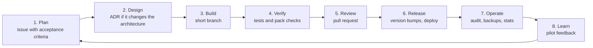

# Software development lifecycle

How work moves from an idea to students' phones. The project has two kinds of change that
follow different paths, and most confusion comes from mixing them up.

| Kind of change | Examples | Who | Path |
|---|---|---|---|
| **Code** | Engine rules, screens, server, tools | Engineers | Pull request, tests, release |
| **Shared content** | A card in a chapter, a core service, a translation | Content authors and engineers | Pull request, content tests, release |
| **Institution content** | A service's room, a phone number, a reworded card | Institution staff | Staff portal: draft, check, second-person review, publish |

Institution content never needs an engineer or a release. That path is described in
[PORTAL.md](../PORTAL.md). The rest of this document covers the first two.

## Status of this process

The repository began as a hackathon build with a single commit on `main`. The steps below
marked **(to set up)** describe the intended process and are not yet in place. Everything
else can be followed today.

## Lifecycle



### 1. Plan

- Requirements come from the [Build Spec](../First_Year_Sim_Build_Spec.md), the scope in
  [MVP.md](../MVP.md), and pilot feedback.
- Each piece of work is an issue that states the user, the problem and how we will know it
  is done. A card or chapter change names the research source it rests on.
- Work that touches Campus Realities, a helpline number or a real institution's name is
  flagged at this stage, because it needs a non-engineering review before release.

### 2. Design

- A change that adds a container, a dependency, a stored field or a new trust boundary gets
  a decision record in [adr/](adr/README.md) before code is written.
- A change to the save format, the pack schema or an API is noted in the issue, since each
  has a version number that must move with it (see
  [data-model.md](data-model.md#version-numbers)).

### 3. Build

- Branch from `main` with a short-lived branch: `feat/…`, `fix/…`, `content/…`, `docs/…`.
- Keep the boundaries in [architecture.md](architecture.md): game rules in `engine.js`, no
  DOM access outside `main.js`, nothing about an institution in code.
- Conventions and local setup are in [CONTRIBUTING.md](../CONTRIBUTING.md).

### 4. Verify

Run before opening a pull request:

```bash
npm test                 # engine, content rules, every pack, service worker manifest
npm run test:portal      # accounts, isolation, workflow, audit log
```

What these cover, and what still needs a person, is in [testing.md](testing.md).

### 5. Review

- Every change reaches `main` through a pull request reviewed by someone other than its
  author. This mirrors the rule the portal enforces on institutions.
- The reviewer checks behaviour, tests, the affected version numbers and the affected docs.
- **(to set up)** A CI workflow that runs both test suites on every pull request, and branch
  protection on `main` that requires it to pass.

### 6. Release

Use the checklist below. A release is a deploy of `main`.

### 7. Operate

Routine tasks and incident steps are in [runbook.md](runbook.md).

### 8. Learn

- Testing rounds are scheduled in the [README checklist](../README.md#testing-checklist-spec-14).
- `GET /stats` gives completions per chapter and the three feedback answers. Results are
  recorded as they are.
- Findings become issues and re-enter at step 1.

## Definition of done

A change is done when all of these hold:

- [ ] It meets the acceptance criteria in its issue
- [ ] `npm test` and `npm run test:portal` pass
- [ ] New behaviour has a test; a bug fix has a test that failed before the fix
- [ ] New or changed text is in English, passes the writing rules, and `node tools/translate.mjs` has been run
- [ ] The right version numbers are bumped
- [ ] Affected documents are updated in the same pull request
- [ ] It was played once in a browser, including offline, if it touches the app
- [ ] Someone else reviewed it

## Release checklist

1. `main` is green on both test suites.
2. Version numbers:
   - [ ] `VERSION` in `sw.js` if any precached file changed
   - [ ] `version` in `content/core.json` if shared content or a chapter changed
   - [ ] `SAVE_VERSION` only if the save format changed incompatibly
   - [ ] New files that must work offline are listed in `ASSETS` in `sw.js`
3. `npm run pack:check <id>` passes for every institution, with `--online` to test links.
4. `node tools/pack-audit.mjs` shows no phone check or licence about to lapse.
5. Back up the databases: `python -m server.admin backup`.
6. Deploy (see [runbook.md](runbook.md#deploy)).
7. Smoke test on the deployed site: open, play one week, go offline and reload, open the
   portal sign-in page.
8. Tag the commit `vX.Y.Z` and add an entry to [CHANGELOG.md](CHANGELOG.md).

## Versioning

The app as a whole follows semantic versioning in `package.json`:

| Part | Bump when |
|---|---|
| Major | Saves or published packs from the previous version stop working |
| Minor | A new chapter, screen, endpoint or pack capability |
| Patch | Fixes and content corrections |

This is separate from the four runtime version numbers, which exist so that phones and
saved games react correctly to a change.

## Environments

| Environment | Purpose | How |
|---|---|---|
| Local | Development | `npm start` (static only) or `python serve.py` (with API and portal) |
| Phone test | Low-cost Android on slow data | A static deploy, or an HTTPS tunnel to a local server |
| Staging **(to set up)** | Pilot rehearsal with real staff accounts | Same as production, separate `data/` |
| Production **(to set up)** | Students and institutions | See [runbook.md](runbook.md) |

## Roles

| Role | Responsible for |
|---|---|
| Engineer | Code, tests, releases, operations |
| Content author | Cards, chapters and translations in the shared story |
| Subject reviewer | Campus Realities wording (a support professional); translations (first-language speakers) |
| Institution editor and reviewer | Their own pack, through the portal |
| Platform admin | Institutions, staff accounts, licences |

One person can hold several roles. Review by a second person is the constant.
