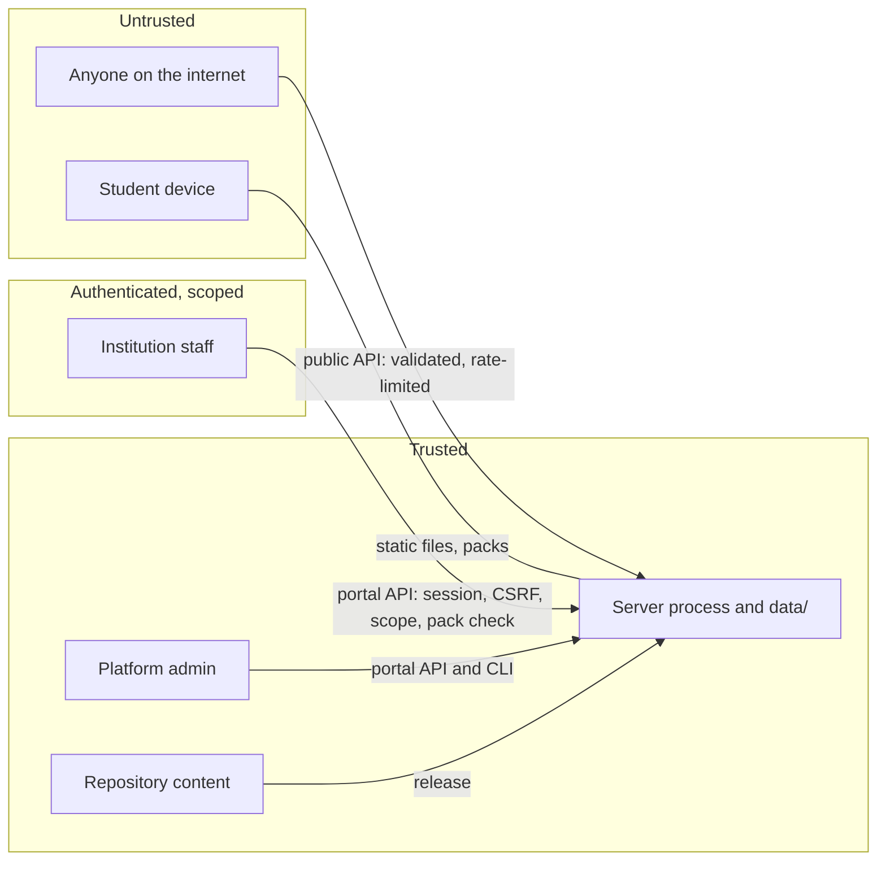

# Security and privacy

What we protect, from whom, and what data the system holds. The portal's individual security
measures are listed in [PORTAL.md](../PORTAL.md#security); this document gives the overall
model. Open items are tracked in [risks.md](risks.md).

## Principles

1. **Collect nothing personal from students.** No account, no name, no login.
2. **The sensitive section leaves no trace.** Campus Realities is never scored, saved or sent.
3. **Students are never shown an unverified phone number.**
4. **Institutions change wording, never rules, and only their own.**
5. **Every publish has two people and a permanent record.**
6. **Secrets stay on the server.**

## Assets

| Asset | Why it matters |
|---|---|
| Student trust and safety | A wrong helpline number or a misleading card can cause real harm |
| Published packs | They are what every student of an institution sees |
| Staff credentials and sessions | They are the route to changing a pack |
| The audit log | It is the evidence of who changed what |
| Completion statistics | Shown publicly and to institutions; must be honest |

## Trust boundaries

## Threats and controls

| Threat | Control | Where |
|---|---|---|
| A pack shows students a false phone number | Demo packs may carry none; licensed packs need `verified` and `last_checked`; numbers unchecked for 400 days are hidden; national lines always stay | `tools/pack-check.mjs`, `mergeSupport` in `js/content.js` |
| A pack breaks the game | The check plays the full journey on every campus before submit and again before publish | `tools/pack-check.mjs`, `Portal.submit`, `Portal._publish` |
| A pack changes game rules | Edits limited to wording fields; an institution's own cards can be added or changed only by a platform admin, and are validated | `tools/pack-check.mjs`, `Portal.save` |
| Script injection through content | Everything is escaped on output; links must be `https://`; the portal has a strict Content-Security-Policy | `esc()` in `js/main.js` and `portal/portal.js`, `serve.py` |
| Staff of one institution reach another's data | Scope enforced on the server for every request; out-of-scope ids return 404 | `Portal._scope` |
| One person publishes alone | The submitter cannot approve, whatever their role | `Portal.review` |
| Stolen or guessed password | scrypt hashes, 12-character minimum, two-step login, and a lock after 8 failures that only an emailed reset link or an admin lifts | `server/auth.py`, `Portal.login` |
| Stolen database used to log in | Session, invitation and reset tokens stored only as hashes | `auth.token_hash` |
| Cross-site request forgery | SameSite=Strict cookie plus a per-session token in a header | `server/web.py` |
| Lost update between two editors | Revision number checked on save | `Portal.save` |
| Tampering with history | Append-only audit table; versions never rewritten; rollback makes a new version | `server/db.py` |
| Fake or inflated statistics | Schema validation, one row per device and chapter, rate limits per device and per address, origin check | `clean_stats`, `save_stats` in `serve.py` |
| Private files served over HTTP | Only the app's own folders are served. The check is made on the file an address resolves to, so capitals, percent-encoding and `..` cannot reach anything else | `Handler.public_file` in `serve.py` |
| Someone nearby sees a sensitive screen | Quick exit on every Campus Realities screen; history entry replaced | `js/main.js` |

Controls with known weaknesses are listed in [risks.md](risks.md) rather than here, so this
table states intent and that one states reality.

## Data inventory

| Data | Personal | Where | Retention | Who can read it |
|---|---|---|---|---|
| Game progress and setup answers | No (nothing identifies the student) | Student's device | Until the student erases it or clears site data | Only that device |
| Campus Realities viewing | n/a | Memory only | Until the page closes | Nobody |
| Random device id | Pseudonymous | Student's device; `data/stats.db` | Not yet defined | Server operators |
| Chapter completions and feedback | No | `data/stats.db` | Not yet defined | Public in aggregate (`GET /stats`); institution staff for their own |
| Staff name, email, role | Yes | `data/portal.db` | While the account exists | Platform admins |
| Staff password hash, two-step secret, hashes of backup codes | Yes, sensitive | `data/portal.db` | While the account exists | Server operators |
| Audit log: email, action, IP address | Yes | `data/portal.db` | Permanent by design | Platform admins; institution reviewers for their own |
| Invitation and reset emails (demo mode) | Yes | `data/outbox/` | Until deleted by hand | Server operators |

### Student controls

The Privacy screen has an "erase everything on this device" button, which removes the save
and preferences. Because nothing else about the student is stored anywhere, that is a
complete erasure apart from anonymous completion rows.

### Before a pilot with real institutions

These need a decision by someone with legal responsibility, not only an engineer:

- Whether the staff data and audit log (which includes IP addresses) require a privacy
  notice and a retention period under POPIA.
- A retention period for `stats.db`.
- Who the responsible party is when an institution's staff enter incorrect information.

## Secrets and configuration

| Variable | Secret | Purpose |
|---|---|---|
| `SMTP_PASSWORD` | Yes | Mail server login |
| `SMTP_HOST`, `SMTP_PORT`, `SMTP_USER`, `SMTP_FROM`, `SMTP_STARTTLS` | No | Mail delivery |
| `PORTAL_URL` | No | Public address used in emailed links |
| `FYS_APP_ORIGIN` | No | The one other origin allowed to call the API |
| `PORTAL_MFA=off` | No | Disables two-step login. Demo only |
| `PORTAL_INSECURE_COOKIE=1` | No | Allows the session cookie over plain HTTP. Demo only |

Secrets are set in the server's environment. They are never committed and never sent to the
browser.

## Reporting a problem

Report a suspected vulnerability privately to the maintainers rather than in a public issue.
How to report and what is in scope is in [SECURITY.md](SECURITY.md). A contact address should
be added there and to `contact.email` in `content/core.json` before the first pilot.
