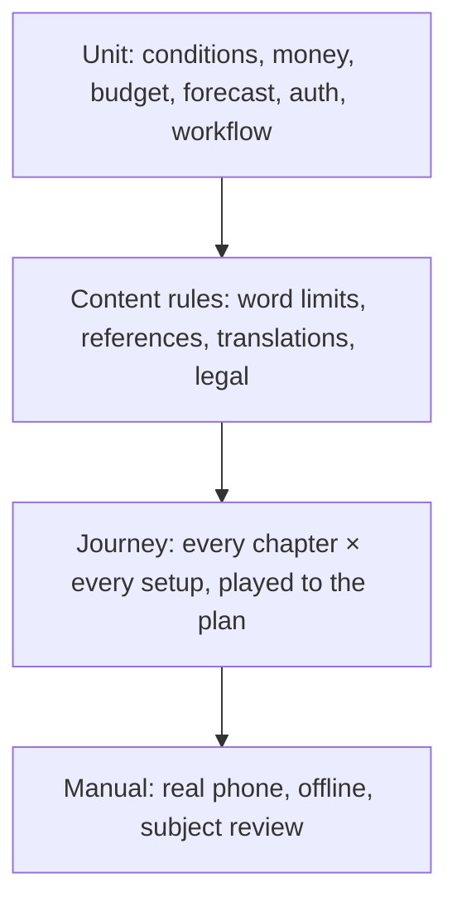

# Test strategy

## Goals

The tests exist to guarantee four things, in this order:

1. **No student ever gets stuck.** Every chapter plays to its end for every setup.
2. **No student is shown something false or unsafe.** No invented phone numbers, no real
   university names, no placeholder text, no missing translations.
3. **No institution can break the game or see another's data.**
4. **The app works offline.**

## What runs automatically

| Suite | Command | Count | Runtime |
|---|---|---|---|
| App and content | `npm test` | 48 tests | about 20 s |
| Staff portal and server | `npm run test:portal` | 36 tests | under a minute |
| One pack | `npm run pack:check <id>` | n/a | about 1 s |

Both use only the standard test runners (`node --test`, `unittest`). There are no test
dependencies to install.

### Levels

| Level | Where | Examples |
|---|---|---|
| Unit | [test/engine.test.mjs](../test/engine.test.mjs), [test/test_portal.py](../test/test_portal.py) | Conditions engine; cost caps; Friday habit; budget tiers; password hashing; lockout; one-time codes |
| Content rules | [test/engine.test.mjs](../test/engine.test.mjs) | Situation at most 40 words; labels at most 6 words; 2 to 3 choices; every referenced service, flag and pool exists; every text has English and isiZulu; every UI key exists |
| Legal and safety | [test/engine.test.mjs](../test/engine.test.mjs) | No real university names; phone numbers only on verified national services |
| Journey | [test/engine.test.mjs](../test/engine.test.mjs), [tools/pack-check.mjs](../tools/pack-check.mjs) | Every setup plays every chapter; money never below zero; every placeholder is filled |
| Pack | [tools/pack-check.mjs](../tools/pack-check.mjs) | Run for every bundled pack in `npm test`, and by the portal before submit and before publish |
| Workflow and isolation | [test/test_portal.py](../test/test_portal.py) | Staff cannot see other institutions; nobody approves their own submission; rollback; audit log cannot be changed |
| Public server | [test/test_server.py](../test/test_server.py) | Only the app's own files are served, however the address is spelled; completion counts are validated, counted once and rate-limited |
| Offline manifest | [test/engine.test.mjs](../test/engine.test.mjs) | The service worker precaches every content file |

The engine is a pure state machine with a seed, so journey tests are deterministic.

## What needs a person

These cannot be automated and are tracked in the
[README checklist](../README.md#testing-checklist-spec-14).

| Check | Who | When |
|---|---|---|
| Low-cost Android phone on slow data | Engineer | Before each release |
| Offline after first load; server down | Engineer | Before each release |
| Quick exit works on every Campus Realities screen | Engineer | When that section changes |
| Campus Realities wording | A support professional | Before `reviewed: true` is set |
| isiZulu and the five machine-translated languages | First-language speakers | Before any pilot |
| National helpline numbers | Engineer or content author | Before launch, then on the audit schedule |
| Institution names are not real | Platform admin | When an institution is added |
| Play-testing rounds with students | Team | As scheduled |
| The staff portal's screens, by hand ([portal-testing.md](portal-testing.md)) | Engineer | A 10-minute check after any portal change; the full test before a pilot |

## Gaps

Known areas with no automated coverage. Each is a candidate for future work.

| Gap | Risk it leaves |
|---|---|
| No browser tests of `main.js` (rendering, navigation, storage, undo) | A screen can break without a test failing |
| No test of the service worker's behaviour, only its file list | Update and offline regressions |
| No browser test of reopening an old save against a newer pack | The check that finds the missing answers is tested; the screen that asks for them again is not |
| No continuous integration | Tests run only when someone remembers |
| No accessibility or performance budget checks | Regressions on low-end phones |

## Adding tests

- A new engine rule gets a unit test beside the existing ones in `test/engine.test.mjs`.
- A new content rule is added once, to the content-validation test, so it applies to every
  card. If institutions must obey it too, add it to `tools/pack-check.mjs`.
- A new portal rule is tested through the `Portal` class with the injected clock and check,
  not through HTTP, unless the rule lives in the web layer.
- A bug fix starts with a test that reproduces the bug.
